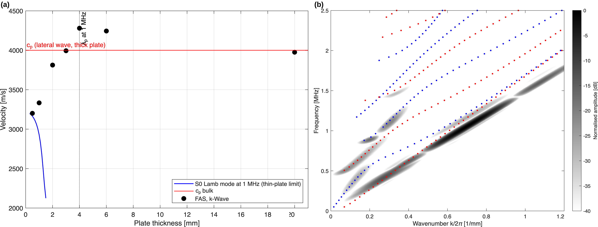
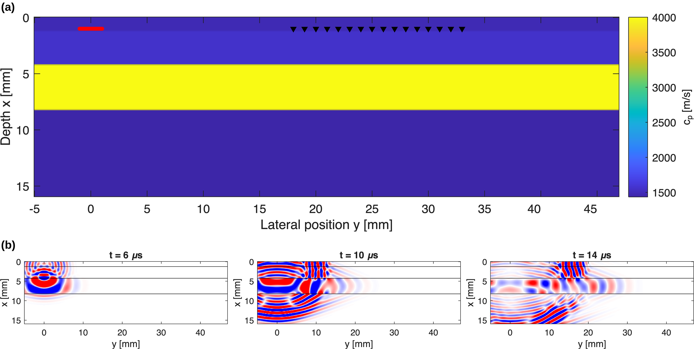
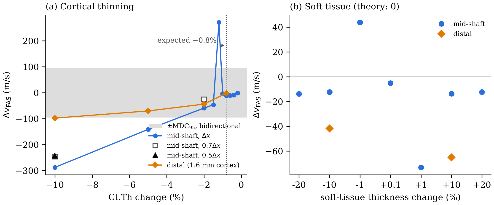
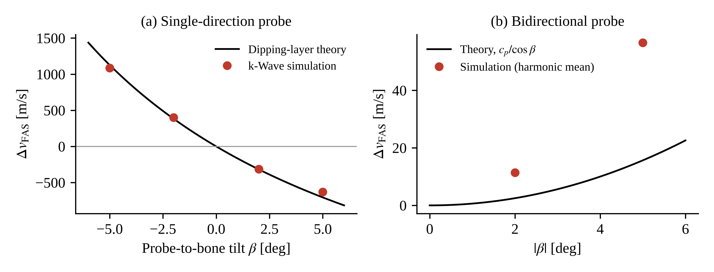
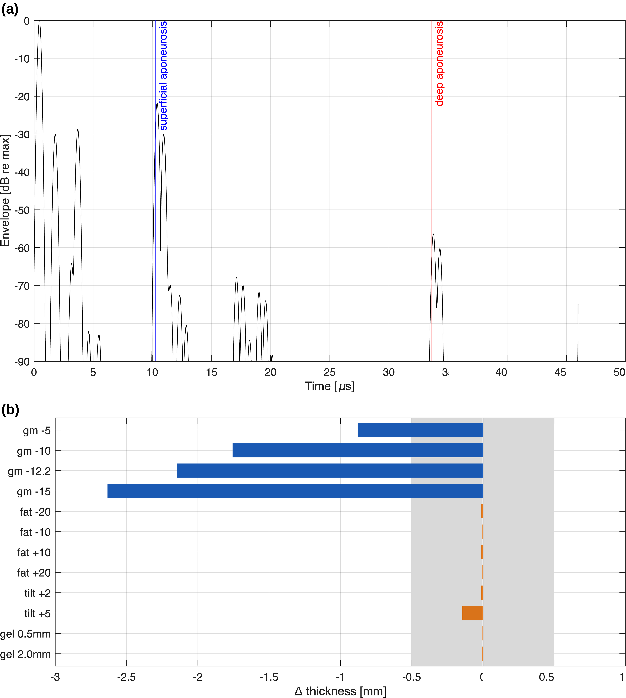
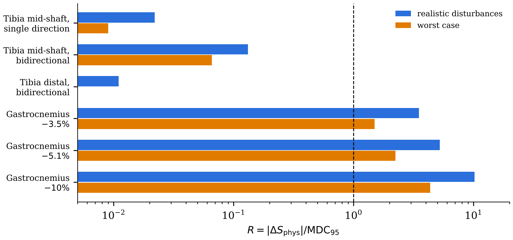

# Wearable ultrasound for bone and muscle monitoring in long-duration spaceflight

[](https://doi.org/10.5281/zenodo.23982476)
[](https://creativecommons.org/licenses/by/4.0/)

Project page of the preprint

> **Feasibility of a wearable ultrasound sensor for monitoring tibial cortical bone and calf muscle in long-duration spaceflight: physiological signal versus measurement uncertainty**
> Lucio De Flumeri, 2026. Preprint, version 1.0. Zenodo. https://doi.org/10.5281/zenodo.23982476

The full text (PDF) is on Zenodo. This repository describes the study and its results; it contains no simulation code.

## Question

Astronauts on six-month missions lose cortical bone and antigravity muscle, but the reference measurements (DXA, HR-pQCT, MRI) are taken only before and after flight. A wearable ultrasound sensor could measure more often, without radiation or an operator. Wearing the sensor adds its own uncertainty: the probe is put on again at every session, the coupling layer changes, and the fluid shift changes the thickness of the soft tissues.

The study asks whether the change expected after six months is larger than the smallest change the wearable sensor can detect between a pre-flight and an in-flight session:

$$R = \frac{|\Delta S_{\mathrm{phys}}|}{\mathrm{MDC}_{95}} \geq 1 \ ?$$

## Approach

- Two-dimensional full-wave simulations with the k-Wave toolbox (MATLAB): the elastic solver for bone, the fluid solver for muscle.
- **Tibia:** axial transmission at 1 MHz, velocity of the first arriving signal (FAS), at the mid-shaft (4 mm cortex) and at the distal site (1.6 mm cortex).
- **Calf:** pulse-echo (A-mode) thickness of the medial gastrocnemius at 7.5 MHz.
- Numerical verification against analytical solutions (bulk velocities, bone plates, Lamb modes, PML, grid convergence).
- Expected six-month changes taken from spaceflight and bed-rest studies.
- Wearable disturbances: soft-tissue thickness (fluid shift), probe tilt and shift, coupling-gel thickness, electronic noise, muscle sound speed.
- Measurement uncertainty propagated with a Monte Carlo analysis of a pre-flight/in-flight comparison (GUM Supplement 1), giving the 95% minimum detectable change (MDC₉₅) and the detection probability.

## Main results

| Site | Expected change | MDC₉₅ (realistic) | R |
|---|---|---|---|
| Tibia mid-shaft, single-direction probe | −12.6 m/s | 563 m/s | 0.02 |
| Tibia mid-shaft, bidirectional probe | −12.6 m/s | 95 m/s | 0.13 |
| Tibia distal, bidirectional probe | −1.9 m/s | 173 m/s | 0.01 |
| Gastrocnemius (thickness −3.5% to −10%) | −0.61 to −1.76 mm | 0.172 mm | 3.5 to 10.2 |

- **Tibial cortical bone:** the expected change is far below the MDC. Probe tilt dominates the uncertainty, in agreement with a closed-form dipping-layer model, and the simulated response to cortical changes of 1–2% is irregular and not grid-converged.
- **Gastrocnemius:** the A-mode thickness measurement is differential, so fluid shift in the superficial layers, coupling and small tilts have little effect. The expected loss exceeds the MDC under realistic disturbances (R = 3.5 to 10.2) and in the worst case (R = 1.5 to 4.4). The stability of the muscle sound speed sets the limit.

Within the limits of a 2D model, muscle thickness is the more promising quantity for in-flight monitoring, whereas tibial cortical bone cannot be followed reliably with a wearable probe.

## Figures

| | |
|---|---|
|  |  |
| Numerical verification on bone plates | Tibia model and pressure field |
|  |  |
| FAS response to cortical thinning and soft tissue | Effect of probe tilt: simulation and theory |
|  |  |
| Gastrocnemius A-mode measurement | Signal-to-MDC ratio R for each site |

## Limitations

The model is two-dimensional and has no tibial curvature or out-of-plane probe shift. Bone is isotropic with axial properties, and the porosity model gave a porosity sensitivity of the wrong sign. Several inputs are assumptions (muscle sound-speed range, Ct.Th gradient, Monte Carlo distributions). Intramuscular fluid shifts and probe pressure were not simulated. No result has yet been validated against phantom or in vivo measurements. See Section 5.5 of the preprint for the full list.

## Possible use in a countermeasure

As a proposal, not tested in the study: gastrocnemius thickness tracked over weeks against a pre-flight reference could inform the dose of a neuromuscular electrical stimulation (NMES) countermeasure.

## Code and data

The simulation code and the data supporting the results are available from the author on reasonable request.

## How to cite

```bibtex
@misc{deflumeri2026wearable,
  author    = {De Flumeri, Lucio},
  title     = {Feasibility of a wearable ultrasound sensor for monitoring tibial cortical bone and calf muscle in long-duration spaceflight: physiological signal versus measurement uncertainty},
  year      = {2026},
  publisher = {Zenodo},
  version   = {1.0},
  doi       = {10.5281/zenodo.23982476},
  url       = {https://doi.org/10.5281/zenodo.23982476},
  note      = {Preprint}
}
```

## Author

Lucio De Flumeri, independent researcher, Italy
ORCID: [0009-0000-4680-4555](https://orcid.org/0009-0000-4680-4555) · LinkedIn: [lucio-de-flumeri](https://www.linkedin.com/in/lucio-de-flumeri) · deflumerilucio@gmail.com

MSc student in Biomedical Engineering (aerospace curriculum, LM-21), University "G. d'Annunzio" of Chieti–Pescara, Italy. This work was carried out independently, without institutional support.

## License

Text and figures: [Creative Commons Attribution 4.0 International (CC BY 4.0)](https://creativecommons.org/licenses/by/4.0/), the same licence as the preprint.
